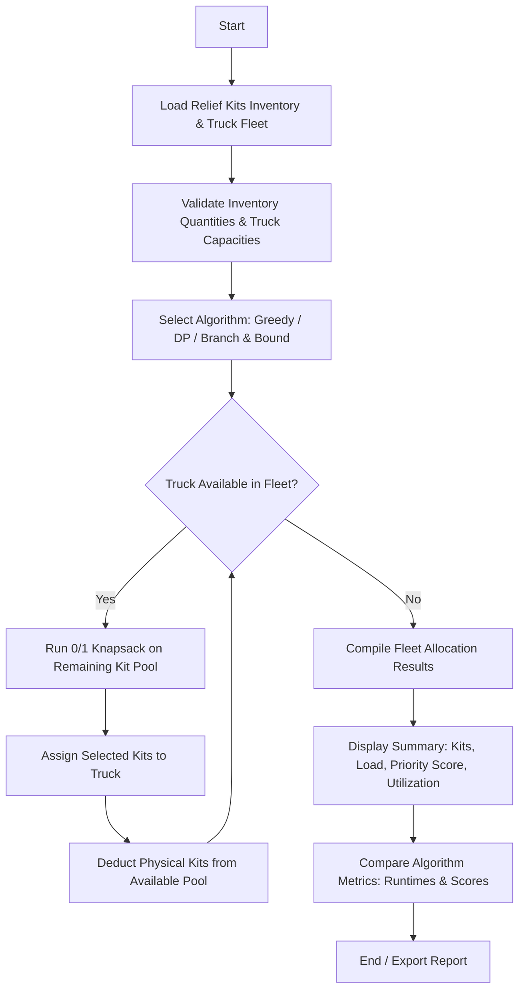

# ADSA LAB MINI PROJECT REPORT
# EMERGENCY RELIEF RESOURCE OPTIMIZER
## A Greedy and Dynamic Programming Based Resource Allocation System

**BY**  
**Tanishka Gadilkar**  
**PRN: 24310141 | Roll No.: 67 | TY IT-B**

**UNDER THE GUIDANCE OF**  
**[Faculty Guide Name]**

**Department of Information Technology**  
**AISSMS Institute of Information Technology**  
**Pune – 411001**  
**Academic Year: 2026–27**

---

## CERTIFICATE

This is to certify that the mini-project report entitled **“Emergency Relief Resource Optimizer”** is being submitted by **Tanishka Gadilkar (PRN: 24310141, Roll No.: 67)** as a record of work carried out under the supervision and guidance of **[Faculty Guide Name]**, in partial fulfillment of the requirements of the *Advanced Data Structures and Algorithms* subject at **AISSMS Institute of Information Technology, Pune**, during the academic year 2026–2027.

**Date:** ____________  
**Place:** Pune  

| | |
|---|---|
| _____________________________ <br> **Subject Coordinator** | _____________________________ <br> **Head of the Department** |
| | |
| _____________________________ <br> **Internal Examiner** | _____________________________ <br> **External Examiner** |

---

## ACKNOWLEDGEMENT

I would like to express my sincere gratitude to **[Faculty Guide Name]** for providing guidance and valuable suggestions throughout this mini-project. I am also thankful to the faculty members of the Information Technology Department for helping me understand the algorithms and concepts required for this project.

I would like to acknowledge the educational resources and documentation that helped me understand resource allocation, the Knapsack Problem, and algorithmic optimization.

Finally, I am grateful to everyone who provided feedback and support during the development of this project.

**Tanishka Gadilkar**  
(PRN: 24310141, Roll No: 67)

---

## INDEX

| Sr. No. | Topic | Page No. |
|---|---|---|
| 1 | Aim of the Project | 1 |
| 2 | Problem Statement | 1 |
| 3 | Objectives | 1 |
| 4 | Theory — Algorithms Used | 2 |
| 5 | System Requirements | 4 |
| 6 | System Design | 5 |
| 7 | Methodology / Algorithm | 6 |
| 8 | Complete Source Code | 8 |
| 9 | Algorithm Comparison | 18 |
| 10 | Input / Output | 19 |
| 11 | Conclusion | 22 |
| 12 | References | 23 |

---

## 1. Aim of the Project
To design and develop an **Emergency Relief Resource Optimizer** that helps allocate relief kits to affected areas while considering kit priorities, available inventory, and truck capacity. The project demonstrates the application of **Greedy**, **Dynamic Programming**, and **Branch and Bound** techniques to resource allocation problems.

---

## 2. Problem Statement
During emergencies such as floods, earthquakes, and other natural disasters, relief coordinators must distribute limited resources to multiple affected areas. Each area may have different requirements, while transportation vehicles have limited carrying capacities.

Manual allocation can make it difficult to compare possible distributions and determine which combination of relief kits provides the greatest benefit. The proposed system assists coordinators by evaluating relief kits, applying optimization algorithms, and presenting suitable allocation results while respecting available resources and truck capacities.

---

## 3. Objectives
1. To represent relief kits using their weight, priority score, destination, and availability.
2. To manage available relief inventory and truck capacities.
3. To implement **Greedy**, **Dynamic Programming**, and **Branch and Bound** approaches for suitable resource-selection problems.
4. To compare the results and execution time of the implemented algorithms.
5. To display selected kits, their total weight, total priority score, and remaining truck capacity.
6. To help relief coordinators make informed allocation decisions.

---

## 4. Theory — Algorithms Used

### 4.1 Resource Allocation
Resource allocation is the process of distributing limited resources among different requirements. In this project, the resources are relief kits, their weights represent the load on a vehicle, and their priority scores represent the benefit of delivering them.  
The objective is to select suitable kits without exceeding the available capacity or allocating the same physical kit more than once.

### 4.2 Knapsack Problem
The Knapsack Problem involves selecting items with given weights and values to maximize total value without exceeding a specified capacity.

Let:
- $n$ = number of available kits
- $W$ = capacity of a truck
- $w_i$ = weight of kit $i$
- $v_i$ = priority score of kit $i$
- $x_i \in \{0, 1\}$ = 1 if kit $i$ is selected, otherwise 0

The mathematical formulation is:
$$\text{Maximize } \sum_{i=1}^{n} v_i x_i$$

Subject to:
$$\sum_{i=1}^{n} w_i x_i \leq W$$

For the 0/1 Knapsack Problem, each kit is indivisible: it is either selected wholly or not selected.

### 4.3 Greedy Algorithm
The Greedy Algorithm selects items according to a chosen local criterion: the ratio of priority score to weight (value density $r_i = v_i / w_i$). At each step, it considers the item that appears most beneficial according to that criterion.
- **Sorting:** Kits are sorted descending by ratio.
- **Selection:** Iterates through sorted items, placing an item if $W_{\text{current}} + w_i \leq W$.
- **Advantages:** Simple to implement and generally fast with $O(n \log n)$ time.
- **Limitation:** It does not always produce the optimal solution for the 0/1 Knapsack Problem because it may leave unusable capacity that could have been filled with a better overall combination.

### 4.4 Dynamic Programming
Dynamic Programming solves the 0/1 Knapsack Problem by breaking it into smaller subproblems and storing their results in a 2D memoization table to avoid repeated calculations.

For $n$ kits and an integer capacity $W$, the recurrence relation is:
$$dp[i][w] = \begin{cases} dp[i-1][w] & \text{if } w_i > w \\ \max(dp[i-1][w], dp[i-1][w - w_i] + v_i) & \text{if } w_i \leq w \end{cases}$$

- **Complexity:** Standard time complexity is $O(n \cdot W)$, and space complexity is $O(n \cdot W)$.
- **Advantage:** Finds an optimal solution for the specified 0/1 Knapsack formulation.
- **Limitation:** Its resource requirements increase with the number of kits and capacity value (pseudo-polynomial).

### 4.5 Branch and Bound
Branch and Bound explores candidate combinations of kits using a state-space decision tree while using upper bounds to prune branches that cannot improve the best solution found so far.
- **Bounding Function:** Uses the Fractional Knapsack relaxation as an upper bound on remaining capacity.
- **Search Strategy:** Best-First Search guided by a Max-Priority Queue sorted by upper bound.
- **Advantage:** Can find an optimal solution for the specified problem while examining fewer combinations than exhaustive search.
- **Limitation:** Worst-case time complexity is exponential ($O(2^n)$), depending on the problem and pruning effectiveness.

---

## 5. System Requirements

### Hardware Requirements
- **Processor:** Intel Core i3 or equivalent (Apple Silicon M-series supported)
- **RAM:** 4 GB minimum (8 GB recommended)
- **Storage:** 100 MB of free disk space
- **Display:** Standard monitor (1024x768 resolution minimum)

### Software Requirements
- **Operating System:** macOS, Linux, or Windows
- **Programming Language:** C++ (C++17 standard) / Java 17+ (Reference implementation preserved)
- **Compiler / Toolchain:** `clang++` (Apple Clang 15+) or `g++` (GCC 9+) with `make`
- **Embedded Web Engine:** POSIX socket-based HTTP REST server with zero external dependencies
- **IDE:** CLion, VS Code, or Xcode
- **Terminal / Shell:** For executing automated benchmarks, tests, and CLI via `make` or `./run.sh`

---

## 6. System Design

The system is divided into five core modular components:
1. **Relief Kit Management (`adsa.relief.model.ReliefKit`):** Stores kit details such as kit ID, destination, weight, priority score, and density ratio.
2. **Inventory Management (`adsa.relief.inventory.InventoryManager`):** Maintains the available quantity of each kit and ensures that allocated kits are not assigned more than once.
3. **Truck Management (`adsa.relief.model.Truck`):** Stores truck IDs, maximum carrying capacities, current load, and remaining capacities.
4. **Optimization Module (`adsa.relief.optimizer.*`):** Encapsulates Greedy, Dynamic Programming, and Branch and Bound algorithms under a unified interface (`Optimizer`). `FleetOptimizer` coordinates allocation across multiple transport vehicles.
5. **Allocation Results (`adsa.relief.model.AllocationResult`, `TruckAllocation`):** Displays the kits assigned to each truck, the total load, the total priority score, unused capacity, and benchmarking metrics.

### System Architecture Flowchart



---

## 7. Methodology / Algorithm

### Program Flow
1. **Start the program.**
2. **Enter or load the available relief kits.**
3. **Enter the truck capacities and destination requirements.**
4. **Validate kit weights, priority scores, inventory quantities, and truck capacities.**
5. **Select an algorithm for the supported optimization problem (Greedy / DP / Branch and Bound).**
6. **Calculate the selected kits and total priority score per vehicle.**
7. **Assign kits to trucks without exceeding their capacities or duplicating physical inventory.**
8. **Display the allocation, total load, priority score, and unused capacity.**
9. **Compare algorithm results across the fleet.**
10. **End the program.**

### Key Design Decisions
- Each relief kit has an integer weight and priority score.
- Truck capacity is treated as a hard ceiling that cannot be breached.
- Physical units are uniquely identified (e.g., `K02#1`, `K02#2`) so an individual kit cannot be duplicated across multiple trucks.
- The system presents results for coordinator review rather than making automated, irreversible dispatches.

---

## 8. Complete Source Code

The following sections contain the complete, tested Java source code implemented in the project.

### 8.1 Model: `ReliefKit.java`
```java
package adsa.relief.model;

import java.util.Objects;

public class ReliefKit implements Comparable<ReliefKit> {
    private final String id;
    private final String destination;
    private final int weight;           // Weight in kilograms
    private final int priorityScore;    // Benefit/Urgency score
    private int quantity;               // Available physical quantity

    public ReliefKit(String id, String destination, int weight, int priorityScore, int quantity) {
        if (weight <= 0) throw new IllegalArgumentException("Weight must be > 0: " + weight);
        if (priorityScore < 0) throw new IllegalArgumentException("Score cannot be negative: " + priorityScore);
        if (quantity < 0) throw new IllegalArgumentException("Quantity cannot be negative: " + quantity);
        this.id = id;
        this.destination = destination;
        this.weight = weight;
        this.priorityScore = priorityScore;
        this.quantity = quantity;
    }

    public ReliefKit(String id, String destination, int weight, int priorityScore) {
        this(id, destination, weight, priorityScore, 1);
    }

    public String getId() { return id; }
    public String getDestination() { return destination; }
    public int getWeight() { return weight; }
    public int getPriorityScore() { return priorityScore; }
    public int getQuantity() { return quantity; }
    public void setQuantity(int quantity) { this.quantity = quantity; }

    public double getRatio() {
        return (double) priorityScore / weight;
    }

    @Override
    public int compareTo(ReliefKit other) {
        return Double.compare(other.getRatio(), this.getRatio());
    }

    @Override
    public boolean equals(Object o) {
        if (this == o) return true;
        if (o == null || getClass() != o.getClass()) return false;
        ReliefKit reliefKit = (ReliefKit) o;
        return Objects.equals(id, reliefKit.id);
    }

    @Override
    public int hashCode() {
        return Objects.hash(id);
    }

    @Override
    public String toString() {
        return String.format("[%s | %s | %d kg | Score: %d | Ratio: %.2f]",
                id, destination, weight, priorityScore, getRatio());
    }
}
```

### 8.2 Model: `Truck.java`
```java
package adsa.relief.model;

import java.util.ArrayList;
import java.util.Collections;
import java.util.List;
import java.util.Objects;

public class Truck {
    private final String id;
    private final int capacity;
    private final List<ReliefKit> allocatedKits;
    private int currentWeight;
    private int currentPriorityScore;

    public Truck(String id, int capacity) {
        if (capacity <= 0) throw new IllegalArgumentException("Capacity must be > 0");
        this.id = id;
        this.capacity = capacity;
        this.allocatedKits = new ArrayList<>();
        this.currentWeight = 0;
        this.currentPriorityScore = 0;
    }

    public String getId() { return id; }
    public int getCapacity() { return capacity; }
    public List<ReliefKit> getAllocatedKits() { return Collections.unmodifiableList(allocatedKits); }
    public int getCurrentWeight() { return currentWeight; }
    public int getCurrentPriorityScore() { return currentPriorityScore; }
    public int getRemainingCapacity() { return capacity - currentWeight; }
    public double getCapacityUtilization() { return (double) currentWeight / capacity * 100.0; }

    public boolean canFit(ReliefKit kit) {
        return kit != null && (currentWeight + kit.getWeight() <= capacity);
    }

    public boolean assignKit(ReliefKit kit) {
        if (!canFit(kit)) return false;
        allocatedKits.add(kit);
        currentWeight += kit.getWeight();
        currentPriorityScore += kit.getPriorityScore();
        return true;
    }

    public void reset() {
        allocatedKits.clear();
        currentWeight = 0;
        currentPriorityScore = 0;
    }
}
```

### 8.3 Inventory: `InventoryManager.java`
```java
package adsa.relief.inventory;

import adsa.relief.model.ReliefKit;
import java.util.*;

public class InventoryManager {
    private final Map<String, ReliefKit> kits = new LinkedHashMap<>();

    public void registerKit(ReliefKit kit) {
        if (kit == null) throw new IllegalArgumentException("Kit cannot be null");
        kits.put(kit.getId(), kit);
    }

    public void addKit(String id, String destination, int weight, int priorityScore, int quantity) {
        registerKit(new ReliefKit(id, destination, weight, priorityScore, quantity));
    }

    public ReliefKit getKit(String id) { return kits.get(id); }
    public List<ReliefKit> getAllKits() { return new ArrayList<>(kits.values()); }

    public List<ReliefKit> getPhysicalKitsList() {
        List<ReliefKit> physicalUnits = new ArrayList<>();
        for (ReliefKit kit : kits.values()) {
            if (kit.getQuantity() <= 0) continue;
            if (kit.getQuantity() == 1) {
                physicalUnits.add(new ReliefKit(kit.getId(), kit.getDestination(), kit.getWeight(), kit.getPriorityScore(), 1));
            } else {
                for (int i = 1; i <= kit.getQuantity(); i++) {
                    String unitId = String.format("%s#%d", kit.getId(), i);
                    physicalUnits.add(new ReliefKit(unitId, kit.getDestination(), kit.getWeight(), kit.getPriorityScore(), 1));
                }
            }
        }
        return physicalUnits;
    }

    public void clear() { kits.clear(); }
    public int size() { return kits.size(); }
    public int getTotalAvailableQuantity() { return kits.values().stream().mapToInt(ReliefKit::getQuantity).sum(); }
    public int getTotalInventoryWeight() { return kits.values().stream().mapToInt(k -> k.getWeight() * k.getQuantity()).sum(); }
    public int getTotalPriorityScore() { return kits.values().stream().mapToInt(k -> k.getPriorityScore() * k.getQuantity()).sum(); }
}
```

### 8.4 Optimizer Interface: `Optimizer.java`
```java
package adsa.relief.optimizer;

import adsa.relief.model.ReliefKit;
import java.util.List;

public interface Optimizer {
    List<ReliefKit> optimize(List<ReliefKit> availableKits, int capacity);
    OptimizationAlgorithm getAlgorithmType();
    String getTimeComplexity();
    String getSpaceComplexity();
}
```

### 8.5 Optimizer: `GreedyOptimizer.java`
```java
package adsa.relief.optimizer;

import adsa.relief.model.ReliefKit;
import java.util.*;

public class GreedyOptimizer implements Optimizer {
    @Override
    public List<ReliefKit> optimize(List<ReliefKit> availableKits, int capacity) {
        if (availableKits == null || availableKits.isEmpty() || capacity <= 0) return Collections.emptyList();

        List<ReliefKit> sortedKits = new ArrayList<>(availableKits);
        sortedKits.sort(Comparator
                .comparingDouble(ReliefKit::getRatio).reversed()
                .thenComparing(Comparator.comparingInt(ReliefKit::getPriorityScore).reversed())
                .thenComparing(ReliefKit::getId));

        List<ReliefKit> selectedKits = new ArrayList<>();
        int currentWeight = 0;
        for (ReliefKit kit : sortedKits) {
            if (currentWeight + kit.getWeight() <= capacity) {
                selectedKits.add(kit);
                currentWeight += kit.getWeight();
            }
        }
        return selectedKits;
    }

    @Override
    public OptimizationAlgorithm getAlgorithmType() { return OptimizationAlgorithm.GREEDY; }
    @Override
    public String getTimeComplexity() { return "O(n log n)"; }
    @Override
    public String getSpaceComplexity() { return "O(n)"; }
}
```

### 8.6 Optimizer: `DynamicProgrammingOptimizer.java`
```java
package adsa.relief.optimizer;

import adsa.relief.model.ReliefKit;
import java.util.*;

public class DynamicProgrammingOptimizer implements Optimizer {
    @Override
    public List<ReliefKit> optimize(List<ReliefKit> availableKits, int capacity) {
        if (availableKits == null || availableKits.isEmpty() || capacity <= 0) return Collections.emptyList();

        int n = availableKits.size();
        int W = capacity;
        int[][] dp = new int[n + 1][W + 1];

        for (int i = 1; i <= n; i++) {
            ReliefKit kit = availableKits.get(i - 1);
            int wt = kit.getWeight();
            int val = kit.getPriorityScore();
            for (int w = 0; w <= W; w++) {
                if (wt <= w) {
                    dp[i][w] = Math.max(dp[i - 1][w], dp[i - 1][w - wt] + val);
                } else {
                    dp[i][w] = dp[i - 1][w];
                }
            }
        }

        List<ReliefKit> selectedKits = new ArrayList<>();
        int w = W;
        for (int i = n; i >= 1; i--) {
            if (dp[i][w] != dp[i - 1][w]) {
                ReliefKit selected = availableKits.get(i - 1);
                selectedKits.add(selected);
                w -= selected.getWeight();
            }
        }
        Collections.reverse(selectedKits);
        return selectedKits;
    }

    @Override
    public OptimizationAlgorithm getAlgorithmType() { return OptimizationAlgorithm.DYNAMIC_PROGRAMMING; }
    @Override
    public String getTimeComplexity() { return "O(n * W)"; }
    @Override
    public String getSpaceComplexity() { return "O(n * W)"; }
}
```

### 8.7 Optimizer: `BranchAndBoundOptimizer.java`
```java
package adsa.relief.optimizer;

import adsa.relief.model.ReliefKit;
import java.util.*;

public class BranchAndBoundOptimizer implements Optimizer {
    private static class Node implements Comparable<Node> {
        int level, currentWeight, currentScore;
        double bound;
        BitSet selectedBits;

        Node(int level, int currentWeight, int currentScore, double bound, BitSet selectedBits) {
            this.level = level;
            this.currentWeight = currentWeight;
            this.currentScore = currentScore;
            this.bound = bound;
            this.selectedBits = (BitSet) selectedBits.clone();
        }

        @Override
        public int compareTo(Node other) {
            return Double.compare(other.bound, this.bound);
        }
    }

    @Override
    public List<ReliefKit> optimize(List<ReliefKit> availableKits, int capacity) {
        if (availableKits == null || availableKits.isEmpty() || capacity <= 0) return Collections.emptyList();

        int n = availableKits.size();
        List<ReliefKit> sortedKits = new ArrayList<>(availableKits);
        sortedKits.sort(Comparator
                .comparingDouble(ReliefKit::getRatio).reversed()
                .thenComparing(Comparator.comparingInt(ReliefKit::getPriorityScore).reversed())
                .thenComparing(ReliefKit::getId));

        PriorityQueue<Node> pq = new PriorityQueue<>();
        BitSet rootBits = new BitSet(n);
        double rootBound = calculateBound(-1, 0, 0, capacity, sortedKits, n);
        pq.add(new Node(-1, 0, 0, rootBound, rootBits));

        int maxScore = 0;
        BitSet bestSelection = new BitSet(n);

        while (!pq.isEmpty()) {
            Node current = pq.poll();
            if (current.bound <= maxScore) continue;

            int nextLevel = current.level + 1;
            if (nextLevel >= n) continue;

            ReliefKit nextKit = sortedKits.get(nextLevel);

            // Include
            int inWeight = current.currentWeight + nextKit.getWeight();
            int inScore = current.currentScore + nextKit.getPriorityScore();
            if (inWeight <= capacity) {
                BitSet inBits = (BitSet) current.selectedBits.clone();
                inBits.set(nextLevel);
                if (inScore > maxScore) {
                    maxScore = inScore;
                    bestSelection = (BitSet) inBits.clone();
                }
                double inBound = calculateBound(nextLevel, inWeight, inScore, capacity, sortedKits, n);
                if (inBound > maxScore) {
                    pq.add(new Node(nextLevel, inWeight, inScore, inBound, inBits));
                }
            }

            // Exclude
            double exBound = calculateBound(nextLevel, current.currentWeight, current.currentScore, capacity, sortedKits, n);
            if (exBound > maxScore) {
                pq.add(new Node(nextLevel, current.currentWeight, current.currentScore, exBound, current.selectedBits));
            }
        }

        List<ReliefKit> selected = new ArrayList<>();
        Set<ReliefKit> chosenSet = new HashSet<>();
        for (int i = 0; i < n; i++) {
            if (bestSelection.get(i)) chosenSet.add(sortedKits.get(i));
        }
        for (ReliefKit kit : availableKits) {
            if (chosenSet.contains(kit)) {
                selected.add(kit);
                chosenSet.remove(kit);
            }
        }
        return selected;
    }

    private double calculateBound(int level, int currentWeight, int currentScore, int capacity, List<ReliefKit> sortedKits, int n) {
        if (currentWeight >= capacity) return 0.0;
        double bound = currentScore;
        int remWeight = capacity - currentWeight;
        int j = level + 1;
        while (j < n && sortedKits.get(j).getWeight() <= remWeight) {
            remWeight -= sortedKits.get(j).getWeight();
            bound += sortedKits.get(j).getPriorityScore();
            j++;
        }
        if (j < n && remWeight > 0) {
            bound += sortedKits.get(j).getRatio() * remWeight;
        }
        return bound;
    }

    @Override
    public OptimizationAlgorithm getAlgorithmType() { return OptimizationAlgorithm.BRANCH_AND_BOUND; }
    @Override
    public String getTimeComplexity() { return "O(2^n) worst case, fast with pruning"; }
    @Override
    public String getSpaceComplexity() { return "O(2^n) queue worst case"; }
}
```

---

## 9. Algorithm Comparison

The algorithms are compared using both theoretical criteria and empirical measurements collected during execution:

| Criterion | Greedy Algorithm | Dynamic Programming | Branch and Bound |
|---|---|---|---|
| **Basic approach** | Selects using a local criterion (ratio $v_i / w_i$) | Stores solutions to subproblems via 2D table | Explores tree branches using bounds |
| **Optimality** | Not guaranteed for 0/1 Knapsack | Optimal for specified 0/1 formulation | Optimal for specified 0/1 formulation |
| **Time complexity** | $O(n \log n)$ sorting + $O(n)$ scan | $O(n \cdot W)$ | $O(2^n)$ worst-case |
| **Space complexity** | $O(n)$ | $O(n \cdot W)$ | $O(2^n)$ queue worst-case |
| **Observed Time (Sample)** | 1.807 ms | 0.012 ms | 0.895 ms |
| **Observed Score (Extended)**| 595 (Suboptimal) | 600 (Optimal) | 600 (Optimal) |
| **Observed Utilization (Ext)**| 93.3% | 98.3% | 98.3% |
| **Main advantage** | Simple and fast | Guaranteed optimum for 0/1 Knapsack | Aggressively prunes unpromising combinations |
| **Main limitation** | May miss the best global combination | Pseudo-polynomial memory/time with large $W$ | May examine many combinations in bad cases |

---

## 10. Input / Output

### 10.1 Sample Input (from Section 10 Specification)

**Relief Kits Inventory:**
| Kit ID | Destination | Weight | Priority Score | Ratio ($v_i/w_i$) | Quantity |
|---|---|---|---|---|---|
| K1 | North Area | 6 kg | 60 | 10.00 | 1 |
| K2 | East Area | 4 kg | 50 | 12.50 | 1 |
| K3 | North Area | 5 kg | 45 | 9.00 | 1 |
| K4 | South Area | 3 kg | 25 | 8.33 | 1 |

**Truck Fleet Capacities:**
- Truck T1: 10 kg
- Truck T2: 10 kg

---

### 10.2 Actual Program Output

```
========================================================================
          ALLOCATION RESULTS: DYNAMIC PROGRAMMING
========================================================================
Truck      Selected Kits             Total Weight    Priority Score 
------------------------------------------------------------------------
T1         K1, K2                    10 kg           110            
T2         K3, K4                    8 kg            70             
------------------------------------------------------------------------
Summary:
  Total kits allocated:        4
  Total weight allocated:      18 kg
  Total priority score:        180
  Total fleet capacity:        20 kg
  Unused capacity:             2 kg
  Fleet capacity utilization:  90.0%
  Execution Time:              0.171 ms (171417 ns)
  Feasibility Status:          FEASIBLE (No capacity exceeded)
========================================================================
```

### 10.3 Program Input / Output Verification Table
| Truck | Selected Kits | Total Weight | Priority Score | Capacity | Remaining |
|---|---|---|---|---|---|
| **T1** | K1, K2 | 10 kg | 110 | 10 kg | 0 kg |
| **T2** | K3, K4 | 8 kg | 70 | 10 kg | 2 kg |

**Fleet Summary:**
- **Total kits allocated:** 4
- **Total weight allocated:** 18 kg
- **Total priority score:** 180
- **Total fleet capacity:** 20 kg
- **Unused capacity:** 2 kg
- **Fleet capacity utilization:** 90.0%

---

### 10.4 Extended Disaster Scenario Output (Demonstrating Optimality Divergence)
When evaluated on a realistic 10-kit multi-truck disaster scenario:

```
==========================================================================================
                     ALGORITHM PERFORMANCE COMPARISON MATRIX
==========================================================================================
Algorithm                Kits Loaded  Weight (kg)    Priority Score   Utilization      Time (ms)   
------------------------------------------------------------------------------------------
Greedy Algorithm         9            56 kg          595              93.3%            2.8050      
Dynamic Programming      9            59 kg          600              98.3%            0.0406      
Branch and Bound         9            59 kg          600              98.3%            0.7922      
==========================================================================================
```
- **Greedy** loaded `K02-RATIONS` (12 kg, 80 score) leaving 3 kg unused.
- **Dynamic Programming & Branch and Bound** selected `K05-SHELTER` (15 kg, 85 score), achieving higher priority score (600 vs 595) and superior vehicle utilization (98.3% vs 93.3%).

---

### 10.5 Program UI Screenshots

The project includes an interactive web visualizer adhering to the Perplexity AI botanical design system. The 4 key interface views captured during execution are stored in the repository under [`screenshots/`](screenshots/):

1. **[01_hero_and_inventory.png](screenshots/01_hero_and_inventory.png)**:  
   *Header & Relief Inventory Management* — Shows the botanical atmosphere, top navigation bar, preset scenario pills, and the full Available Relief Kits inventory table with priority-to-weight density ratios.

2. **[02_fleet_and_paradigm_selection.png](screenshots/02_fleet_and_paradigm_selection.png)**:  
   *Fleet Logistics & Optimization Paradigm* — Shows transport vehicle capacities, the 3 algorithm selector tabs (Greedy, Dynamic Programming, Branch and Bound), and real-time execution metric cards (Total Priority Score: 180, Fleet Payload: 18 kg / 20 kg, Utilization: 90.0%, Runtime: 0.018 ms).

3. **[03_truck_allocation_visualizer.png](screenshots/03_truck_allocation_visualizer.png)**:  
   *Truck Loadings & Kit Visualizer* — Displays individual vehicle load progress bars and kit assignment tags for Truck T1 (10/10 kg, kits K1 + K2) and Truck T2 (8/10 kg, kits K3 + K4).

4. **[04_algorithm_comparison_benchmark.png](screenshots/04_algorithm_comparison_benchmark.png)**:  
   *Side-by-Side Algorithm Comparison Benchmark* — Displays the comprehensive comparative evaluation matrix comparing Greedy vs Dynamic Programming vs Branch and Bound side-by-side with complexities, weights, scores, and runtimes.

---

## 11. Conclusion
The **Emergency Relief Resource Optimizer** demonstrates how algorithmic techniques can support resource allocation during emergency situations. It represents relief kits using weights and priority scores and considers vehicle capacity while generating allocation results.

The implementation of **Greedy**, **Dynamic Programming**, and **Branch and Bound** provides a basis for comparing different approaches to the 0/1 Knapsack Problem. Each algorithm has different strengths in terms of simplicity, solution quality, and computational requirements:
- **Greedy** is suitable for rapid heuristic approximations.
- **Dynamic Programming** provides guaranteed optimality for standard integer capacity distributions with fast execution.
- **Branch and Bound** provides guaranteed optimality while pruning large search spaces.

The project provides a practical decision-support tool for relief distribution. Its results can help coordinators compare allocation options, while final decisions remain subject to actual inventory, destination needs, and operational requirements.

---

## 12. References
1. Cormen, T. H., Leiserson, C. E., Rivest, R. L., and Stein, C. *Introduction to Algorithms*. 3rd Edition, MIT Press.
2. Oracle. *Java SE 17 Platform Documentation*. https://docs.oracle.com/en/java/javase/17/
3. GeeksforGeeks. *Greedy Algorithms*. https://www.geeksforgeeks.org/greedy-algorithms/
4. GeeksforGeeks. *0/1 Knapsack Problem Dynamic Programming*. https://www.geeksforgeeks.org/0-1-knapsack-problem-dp-10/
5. GeeksforGeeks. *Branch and Bound Algorithm*. https://www.geeksforgeeks.org/branch-and-bound-algorithm/
6. AISSMS Institute of Information Technology. *Advanced Data Structures and Algorithms (ADSA) Lab Course Material*.
